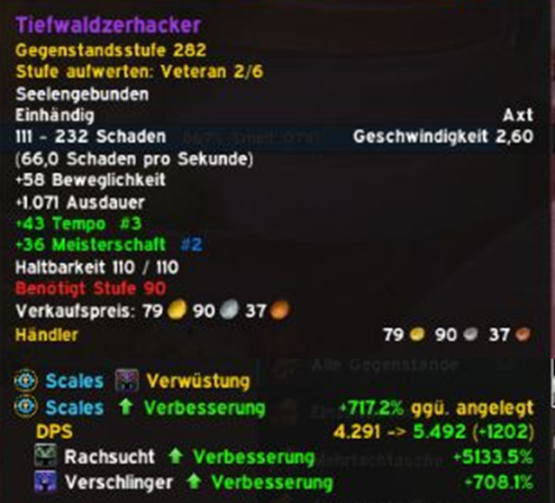
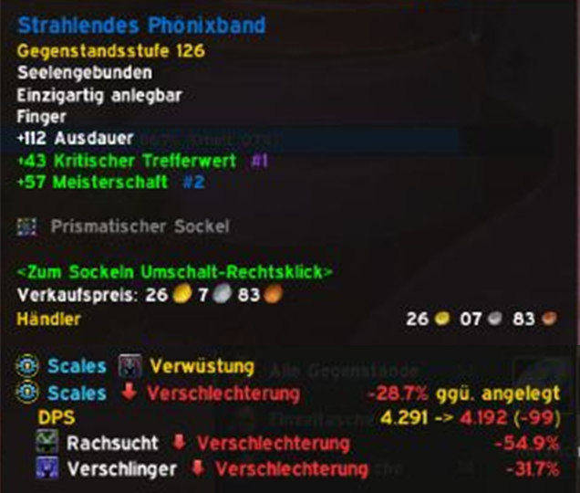
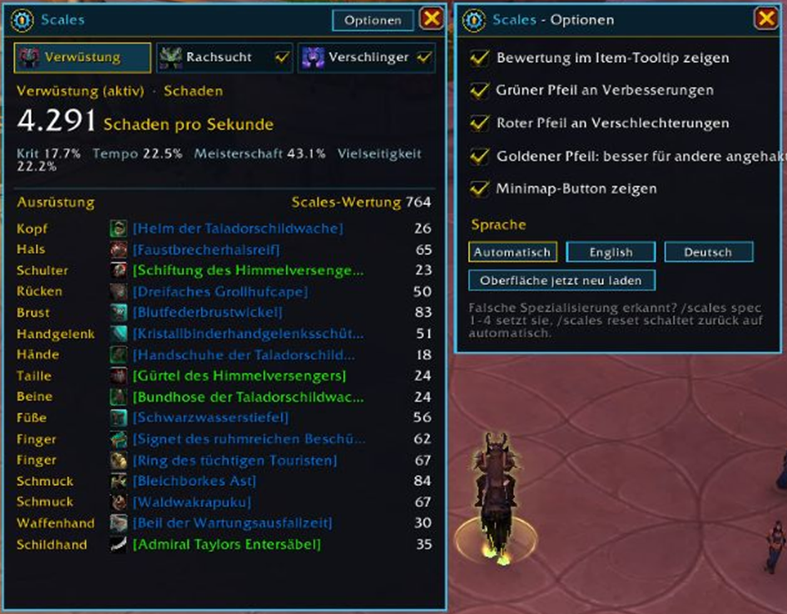

<h1 align="center">Scales</h1>

[English](#english) · [Deutsch](#deutsch)

World of Warcraft addon for Retail (Midnight), WoW: Forever, Mists of Pandaria Classic, Cataclysm Classic, TBC Anniversary and Classic Era · Author: Rottgar · CurseForge project 1770935

  
  

  

---

## English

**Know at a glance whether an item is better.** Scales simulates your character – damage per second for damage dealers, healing per second for healers, effective health and mitigation for tanks – and marks every item like Pawn: green arrow up for upgrades, red arrow down for downgrades. Everything updates automatically, no button to press. English and German.

### Features

**Item ratings**
- Every item tooltip shows whether it is an upgrade or a downgrade compared to what you are wearing, in percent and as a DPS/HPS/EHP change
- Arrows on item icons in your bags: green up (upgrade), red down (downgrade), gold up (upgrade for another of your specs) – also in ElvUI, Bagnon, Baganator, AdiBags, BetterBags and EllesmereUI Bags
- Rings, trinkets and dual wield are compared against your weaker equipped item; two-handers against main hand plus off hand
- Trinket effects (Use, Equip, Chance on hit) are estimated for your role
- Armor you cannot wear is marked; in Retail, items of the wrong armor type never count as upgrades

**All specs at once, like Pawn**
- One tooltip line per specialization, so you see immediately whether an item is better for damage, healing or tanking
- Specs that share the same stat priorities are merged into one line

**Character window**
- `/scales` shows your simulated DPS, HPS or mitigation, your key stats and a rating for every equipped item
- Spec bar: click a specialization to see its values; the tick box decides whether it appears in tooltips
- Live preview while hovering an item: "If equipped: 12,340 -> 12,870"

**Usability**
- Minimap button (drag to move, left click: window, right click: options); in Retail also in the addon compartment
- Options for tooltip, each arrow type, minimap button and language (Auto / English / Deutsch)
- Recalculates after combat instead of during combat, so it never interferes with fights

### Commands
- `/scales` open the window
- `/scales options` options
- `/scales spec 1-4` set the specialization manually, `/scales reset` back to automatic
- `/scales arrows` bag arrows on/off, `/scales minimap` minimap button on/off
- `/scales language en`, `de` or `auto`

### Limits
Scales uses a fast analytical model, not a full rotation simulation like SimulationCraft or Raidbots. Stat weights are sensible defaults per role and primary stat, and trinket effects are estimated. It is made to compare gear quickly, not to replace a full sim.

---

## Deutsch

**Auf einen Blick sehen, ob ein Item besser ist.** Scales simuliert deinen Charakter – Schaden pro Sekunde für Schadensklassen, Heilung pro Sekunde für Heiler, effektive Lebenspunkte und verhinderten Schaden für Tanks – und markiert jedes Item wie Pawn: grüner Pfeil nach oben für Verbesserungen, roter Pfeil nach unten für Verschlechterungen. Alles aktualisiert sich automatisch, ohne Knopfdruck. Deutsch und Englisch.

### Funktionen

**Item-Bewertung**
- Jeder Item-Tooltip zeigt, ob das Item besser oder schlechter ist als deine angelegte Ausrüstung, in Prozent und als DPS-/HPS-/EHP-Änderung
- Pfeile an den Items in den Taschen: grün nach oben (Verbesserung), rot nach unten (Verschlechterung), gold nach oben (Verbesserung für eine andere deiner Spezialisierungen) – auch in ElvUI, Bagnon, Baganator, AdiBags, BetterBags und EllesmereUI Bags
- Ringe, Schmuckstücke und zwei Einhandwaffen werden mit dem schwächeren angelegten Item verglichen, Zweihandwaffen mit Haupt- plus Nebenhand
- Effekte von Schmuckstücken (Benutzen, Anlegen, Trefferchance) werden passend zur Rolle geschätzt
- Nicht tragbare Rüstung wird markiert; in Retail zählt eine falsche Rüstungsklasse nie als Verbesserung

**Alle Spezialisierungen auf einmal, wie bei Pawn**
- Eine Tooltip-Zeile pro Spezialisierung, so siehst du sofort, ob ein Item für Schaden, Heilung oder Tanken besser ist
- Spezialisierungen mit denselben Werte-Prioritäten werden zu einer Zeile zusammengefasst

**Charakterfenster**
- `/scales` zeigt deinen simulierten DPS-, HPS- oder Mitigationswert, die wichtigsten Werte und eine Wertung für jedes angelegte Item
- Spezialisierungs-Leiste: Klick zeigt die Werte dieser Spezialisierung, das Häkchen legt fest, ob sie im Tooltip erscheint
- Live-Vorschau beim Überfahren eines Items: „Wenn angelegt: 12.340 -> 12.870“

**Bedienung**
- Minimap-Button (zum Verschieben ziehen, Linksklick: Fenster, Rechtsklick: Optionen); in Retail auch im Addon-Fach
- Optionen für Tooltip, jede Pfeilart, Minimap-Button und Sprache (Automatisch / English / Deutsch)
- Rechnet nach dem Kampf neu statt währenddessen und stört so nie im Kampf

### Befehle
- `/scales` Fenster öffnen
- `/scales options` Optionen
- `/scales spec 1-4` Spezialisierung von Hand setzen, `/scales reset` zurück auf automatisch
- `/scales arrows` Taschenpfeile an/aus, `/scales minimap` Minimap-Button an/aus
- `/scales language en`, `de` oder `auto` (auch `/scales sprache …`)

### Grenzen
Scales nutzt ein schnelles analytisches Modell, keine vollständige Rotations-Simulation wie SimulationCraft oder Raidbots. Die Stat-Gewichte sind sinnvolle Standardwerte je Rolle und Hauptwert, Schmuckstück-Effekte werden geschätzt. Es ist zum schnellen Vergleichen von Ausrüstung gedacht, nicht als Ersatz für eine vollständige Simulation.

---

Veröffentlichen / Publishing: siehe [VEROEFFENTLICHEN.md](VEROEFFENTLICHEN.md)
